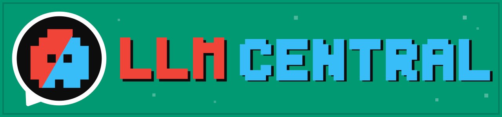
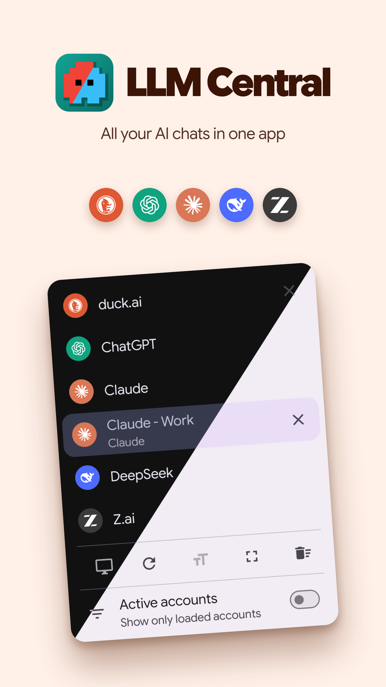
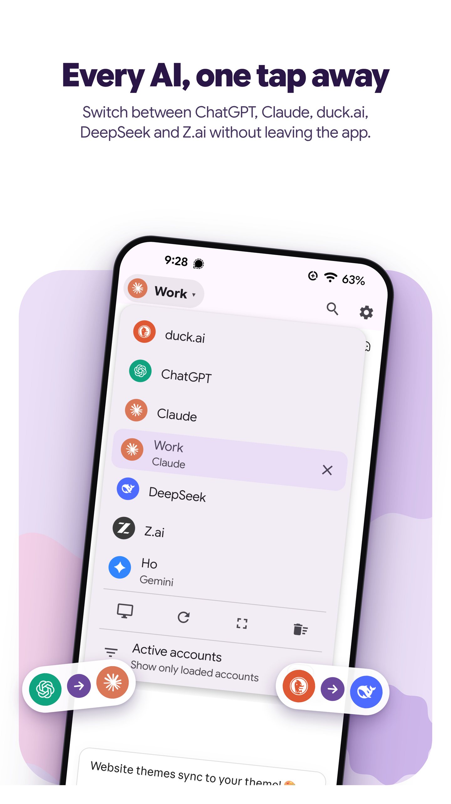
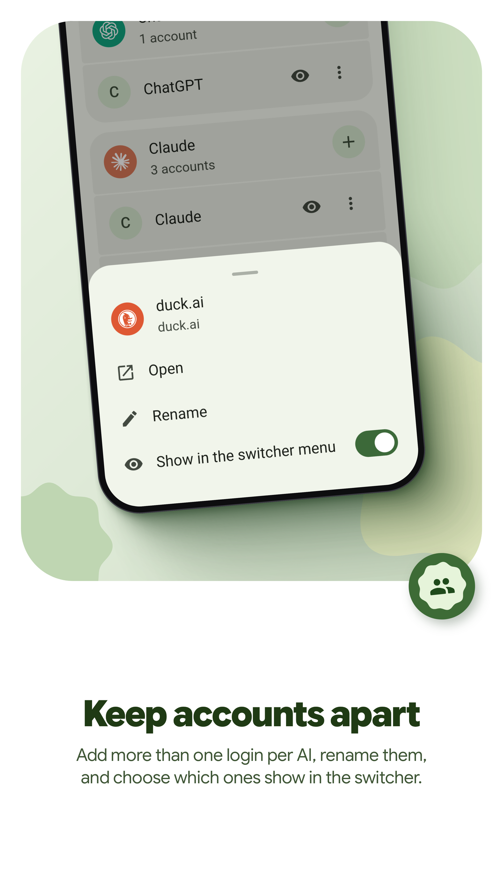
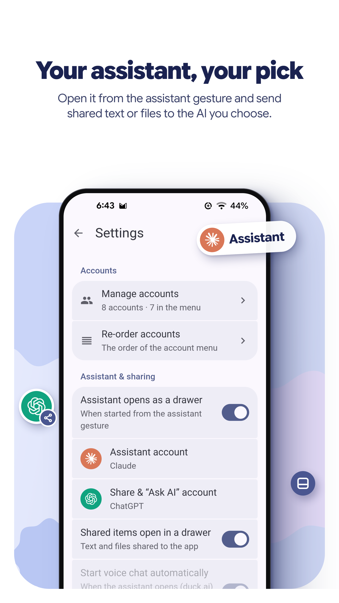
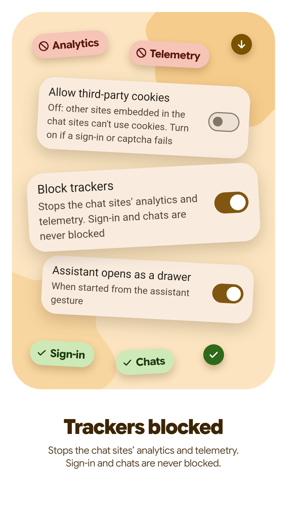
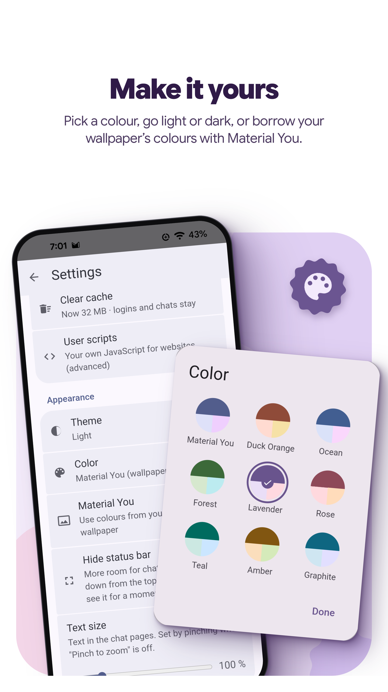
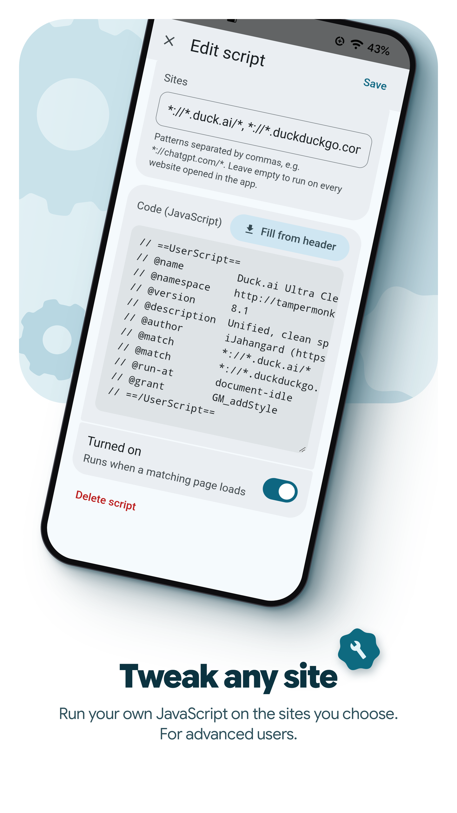

<div align="center">
  

  <h3>Every AI chat in one small, private Android app.</h3>

  <p>
    <a href="../../releases/latest"><picture><source media="(prefers-color-scheme: dark)" srcset="artwork/readme/get-github-dark.svg"></picture></a>
    <!-- Un-comment when the app is listed (and put the public repository's address into the Obtainium link):
    <a href="https://f-droid.org/packages/org.llmcentral.app/"><picture><source media="(prefers-color-scheme: dark)" srcset="artwork/readme/get-fdroid-dark.svg"></picture></a>
    <a href="https://apps.obtainium.imranr.dev/redirect?r=obtainium://add/https://github.com/OWNER/REPO"><picture><source media="(prefers-color-scheme: dark)" srcset="artwork/readme/get-obtainium-dark.svg"></picture></a>
    -->
  </p>
  <p>
    <picture><source media="(prefers-color-scheme: dark)" srcset="artwork/readme/chip-android-dark.svg"></picture>
    <a href="../../releases/latest"><picture><source media="(prefers-color-scheme: dark)" srcset="artwork/readme/chip-release-dark.svg"></picture></a>
    <picture><source media="(prefers-color-scheme: dark)" srcset="artwork/readme/chip-apk-dark.svg"></picture>
    <a href="LICENSE"><picture><source media="(prefers-color-scheme: dark)" srcset="artwork/readme/chip-license-dark.svg"></picture></a>
  </p>

  <p>
    duck.ai, ChatGPT, Claude, DeepSeek, Z.ai and Gemini side by side, with as many separate accounts as you like,<br>
    switched from one tap in the top bar, in an app smaller than most photos.
  </p>

  <p>
    <a href="#screenshots"><b>Screenshots</b></a> ·
    <a href="#features"><b>Features</b></a> ·
    <a href="#download"><b>Download</b></a> ·
    <a href="BUILDING.md"><b>Build it yourself</b></a> ·
    <a href="#license"><b>License</b></a>
  </p>
</div>

---

## Why LLM Central?

Using several AI chats on a phone means a browser full of tabs, one app per company, or signing in and out to switch
accounts. LLM Central keeps them all in one place: each account lives in its own sealed container, so your work and
personal logins never mix, and the chat you used a minute ago is still loaded when you come back.

It wraps the chat websites themselves, so you keep every feature they have, while the app quietly blocks their
trackers. No analytics, no ads, no Google Play Services, and the whole APK is about 270 KB.

## Screenshots

<p align="center">
  <a href="fastlane/metadata/android/en-US/images/phoneScreenshots/1.png"></a>
  <a href="fastlane/metadata/android/en-US/images/phoneScreenshots/2.png"></a>
  <a href="fastlane/metadata/android/en-US/images/phoneScreenshots/3.png"></a>
  <a href="fastlane/metadata/android/en-US/images/phoneScreenshots/4.png"></a>
  <a href="fastlane/metadata/android/en-US/images/phoneScreenshots/5.png"></a>
  <a href="fastlane/metadata/android/en-US/images/phoneScreenshots/6.png"></a>
  <a href="fastlane/metadata/android/en-US/images/phoneScreenshots/7.png"></a>
</p>

## Features

### All your AI chats, one tap apart
- **Six providers** in one app: duck.ai, ChatGPT, Claude, DeepSeek, Z.ai and Gemini.
- **Several accounts per provider**, each in its own container with separate logins, cookies and site data.
- **Instant switching**: recently used accounts stay loaded (you choose how many); unload any of them from the menu.

### Private by default
- **Trackers blocked**: the chat sites' known analytics and telemetry requests are stopped on your phone. Sign-in,
  captchas and chats are never blocked.
- **Third-party cookies blocked** for sites embedded in the chats; your logins are unaffected.
- **No accounts, servers or analytics of our own.** The app talks only to the chat sites you open.

### Made for Android
- **Material You**: light, dark or pure black, eight colour palettes, or your wallpaper's colours (Android 12+).
- **Your assistant**: open a chat with the assistant gesture, share text or files to it, or select text anywhere and
  choose *Ask AI*. You decide which account each one opens.
- **Downloads and uploads that just work**, including files the chat creates and files shared from other apps.
- **Find in page**, desktop mode per account, user scripts for power users.

## Download

<p align="center">
  <a href="../../releases/latest"><picture><source media="(prefers-color-scheme: dark)" srcset="artwork/readme/get-github-dark.svg"></picture></a>
</p>

- **Requirements:** Android 7.0 or newer. Several accounts per provider need a recent *Android System WebView*
  (update it from your app store); with an older one, each provider has one account.
- **What's new:** each [release](../../releases) lists its changes (also in
  [`fastlane/…/changelogs`](fastlane/metadata/android/en-US/changelogs)).
- **Status:** early development; the app works day to day, but expect rough edges.

<details>
<summary><b>Signing in with Google or Apple</b></summary>
<br>

*Continue with Google* and *Continue with Apple* open inside the app, in the account you are signing in to (every
account keeps its own sign-in). Google refuses sign-in inside in-app browsers, so while Google's sign-in page is
open, that one page sees a browser-like user agent (the method [geminiAssist](https://github.com/AcideFluorhydrique/geminiAssist)
uses); every other page sees the normal one. Google may stop this at any time: **email and password or an email code
always work.**
</details>

## Build it yourself

Everything you need (JDK, Android SDK, Android Studio or the command line, tests and checks) is in
**[BUILDING.md](BUILDING.md)**. The short version:

```bash
git clone <this repository's address> && cd <its folder>
./gradlew assembleDebug        # app/build/outputs/apk/debug/
```

## Credits

LLM Central is a fork of [duckAssist](https://github.com/diekaiju/duckAssist) by diekaiju, itself a fork of
[gptAssist](https://github.com/woheller69/gptAssist) by woheller69, and uses parts of
[GMaps WV](https://gitlab.com/divested-mobile/maps). Provider logos come from [Lobe Icons](https://github.com/lobehub/lobe-icons)
(MIT) and [Simple Icons](https://simpleicons.org) (CC0); they are trademarks of their owners. The README badges follow
the design of [Flow](https://github.com/Flow-Tube/Flow)'s. Details: [THIRD_PARTY_NOTICES.md](THIRD_PARTY_NOTICES.md).

## License

LLM Central is free software under the [GNU General Public License v3.0](LICENSE): you may use, study, share and
change it. If you distribute it, you must also offer its source code under the same license.
